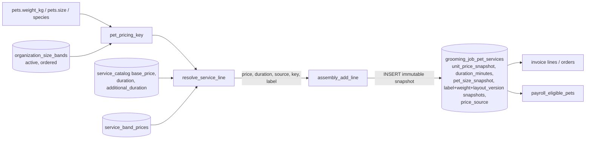
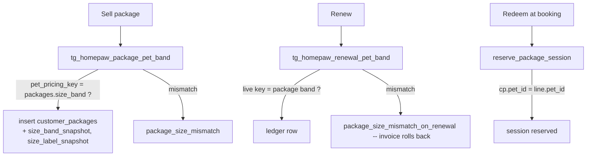

# Dynamic tenant-owned size bands — design response (parity item #21)

Base: `codex/parity-orchestration` @ `8bef156aa745aa958c329adeae66b2cba7cf0ccf`. Latest applied migration on this branch: `20261022100000_platform_owner_workspace_access.sql`.
Scope: design and dependency inventory only. No application code, migration, test, UI, deploy, or data change was produced. Nothing here is end-to-end parity proof; every claim below is from reading source, not from running it.

Sources read: `apps/web/AGENTS.md`, `CLAUDE-DYNAMIC-SIZE-DESIGN.md`, the manifest, `HOMEPAW_PARITY_AUDIT_2026-10-01.md`, `HOMEPAW-CATALOG-SIZE-HANDOFF.md`, `ENGINE-3-S32-S33-HANDOFF.md`, every manifest file, plus additional files found by repo-wide grep (listed in §1 as "not in manifest"). Reference HTML (`Downloads/index (2).html`) was inspected only at: `sizeFromWeight` (L3540), `DUR_BASE/DUR_ADD/dogDur` (L3874–3882), `priceFor` (L7572), `tierMonthlyPrice` (L2791), `SIZE_RANK/tokenMatchesDog` (L9040–9049), payroll `perDog`/`useMatrix` config (L7296, L13466).

Note on `apps/web/AGENTS.md`: it only warns that this Next.js version differs from training data and to read `node_modules/next/dist/docs/` before writing app code. That applies to the implementation task (server actions, route handlers); it does not change this design.

---

## 0. Findings that shape the design

1. **Weight→band logic exists in four independent copies**, not one: SQL `app.dog_size_for_weight` (`20261019110000_org_dog_size_boundaries.sql`), TS `dogSizeFromWeight` (`apps/web/src/lib/pet-sizing.ts:17`), TS `sizeBandForWeight` (`apps/web/src/lib/grooming-profile.ts:20`, hardcoded 5/10/15/25, ignores tenant boundaries), and the SQL `case` in `app.set_dog_size_boundaries` (same migration) that pre-checks package impact. A fifth, dead-but-still-present copy sits in `20261017110000_homepaw_membership_tiers.sql` (`tg_homepaw_package_pet_band` v1) and was superseded by `20261019110000`.
2. **Band comparison semantics are mixed-inclusive and must be preserved**: XS `w<5`, S `w<10`, M `w<15`, **L `w<=25`**, XL `w>25`. A plain `[lower, upper)` model would move a 25.00 kg dog from L to XL. (The HomePaw HTML reference uses `kg<25` for L — a documented divergence; see Open Decision O2. Existing Operro data semantics win.)
3. **`pets.size` is DB-authoritative when weight exists** (trigger `trg_homepaw_pet_size_from_weight`, last redefined in `20261020120000_custom_pet_types.sql`: dogs only, size from weight; everything else nulled). `assembly_add_line` additionally *recomputes* from current weight at line-add time (`coalesce(app.dog_size_for_weight(org, weight), pets.size)`), so the price band is whatever the weight says *then*.
4. **TS can disagree with SQL today.** `pricingBand()` (`pet-sizing.ts:45`) trusts `pet.size` only if it is one of the five hardcoded keys, else falls back to `dogSizeFromWeight(weight)` with **default** boundaries, not the tenant's. A dog with weight but NULL size (possible for rows predating the trigger, since the trigger fires only on write) is banded by default cutoffs in TS and by tenant cutoffs in SQL. Once a sixth key (e.g. `xxl`) exists, `pricingBand` silently returns the wrong band for any pet whose `size='xxl'`.
5. **Payroll prices pet pay from the *live* `pets.size`, not the booking snapshot** (`20261010110000_payroll_engine_s32_rpcs.sql:354-365`: `join public.pets pt … group by pt.size`). `app.payroll_eligible_pets` (same file, L183) returns no size at all. So a boundary edit or weight update changes what a **draft** payroll recompute pays for already-completed jobs; approved/paid `payroll_items.breakdown` stays frozen (S32 handoff §5.10, trigger-enforced). Cats/other species have `pets.size` NULL → flat rate.
6. **Payroll XS is unreachable from the UI today**: `SIZE_KEYS` in `apps/web/src/app/payroll/payroll-actions.ts:34` and `SIZE_LABELS` in `payroll-settings-form.tsx:59` list only `small|medium|large|extra_large`. SQL does not validate matrix keys (plain jsonb; comment at `20261010100000_payroll_engine_s32.sql:98` repeats the 4-key list). `extra_small` is a valid pet size, so an XS dog always falls through to the flat rate — an existing gap, independent of #21, which the new model must close.
7. **Package eligibility is two different mechanisms**: (a) *sale/renewal* is size-checked by triggers (`tg_homepaw_package_pet_band`, `tg_homepaw_renewal_pet_band`) comparing live pet key to `packages.size_band`; (b) *redemption at booking time* is **pet-bound, not size-bound** (`reserve_package_session` in `20260925100000_package_membership_lifecycle.sql:206`: `cp.pet_id <> ln.pet_id` → reject). So an entitlement keeps working after a pet outgrows its band; only renewal at the old size is refused. This is intentional (handoff: "Existing purchased sessions remain available during their original term") and must not change.
8. **Cat is modelled as a pseudo-band**: `price_cat`/`duration_cat` columns, `packages.size_band='cat'`, `pet_size_snapshot='cat'`. Other species use `service_catalog.species_pricing` jsonb and snapshot their species key (`'rabbit'`, asserted in `integration/platform_access_smoke.sql:192`). `chk_gjps_pet_size_snapshot` is already relaxed to regex `^[a-z][a-z0-9_]{1,29}$` (`20261020120000:87-89`), so snapshots are **already** free-form keys; the blockers are elsewhere.
9. **Concrete hard blockers for a 6th band** (anything that would reject or mis-price `xxl`): `chk_pets_size` (`20261017100000`), `chk_packages_size_band` (`20261017110000`), `assembly_add_line` hardcoded `case` (`20261020120000`), both package triggers, `set_dog_size_boundaries` (4 fixed params + fixed `case`), the 12 fixed `service_catalog` columns, `create_customer_household` + onboarding-submit size allowlists (`20261020120000:197`, ~L292), TS `pilot-actions.ts:192/1139`, `pet-sizing.ts`, and all form/matrix components.

---

## 1. Fixed XS/S/M/L/XL dependency inventory

Key: **B** = blocks a 6th band (rejects or mis-prices); **D** = display/label only; **T** = test/fixture asserting fixed keys; **N** = checked, no size dependency. "Legacy keys" = `extra_small, small, medium, large, extra_large` (+ `cat`).

### 1a. SQL — schema and constraints

| Path / symbol | Dependency | Class |
|---|---|---|
| `supabase/migrations/20260924130000_service_size_pricing.sql` | `service_catalog.price_small/medium/large/extra_large`, `additional_duration_minutes`; `chk_pets_size` (4 keys, later replaced); `grooming_job_pet_services.pet_size_snapshot` + `chk_gjps_pet_size_snapshot`; `price_source in (base,size_matrix,manual_override)`; original `app.assembly_add_line`; `app.override_grooming_line_price` (size-agnostic) | B (history; superseded objects) |
| `…/20261017100000_homepaw_size_price_duration.sql` | adds `price_extra_small`, `price_cat`, `duration_extra_small/small/medium/large/extra_large/cat`; `chk_service_price_*`, `chk_service_duration_bands`; **replaces `chk_pets_size` with the 5-key list**; `chk_gjps_pet_size_snapshot` (+`cat`); `create_customer_household` size allowlist; `tg_homepaw_pet_size_from_weight` (hardcoded 5/10/15/25); `assembly_add_line` v3 (6-way `case`) | B |
| `…/20261017110000_homepaw_membership_tiers.sql` | `packages.size_band`, `chk_packages_size_band` (6-key list), `chk_packages_size_requires_pet`, `tg_homepaw_lock_sold_package_size`, `tg_homepaw_package_pet_band` v1 and `tg_homepaw_renewal_pet_band` v1 (hardcoded cutoffs) | B (constraint) / superseded (triggers) |
| `…/20261019110000_org_dog_size_boundaries.sql` | `organization_dog_size_boundaries(xs_lt_kg,s_lt_kg,m_lt_kg,l_lte_kg)` (exactly 4 columns, 5 bands) + `chk_dog_size_boundaries_order`; `app.dog_size_for_weight` (`case … 'extra_small'…'extra_large'`); `app.set_dog_size_boundaries(p_org,p_xs,p_s,p_m,p_l)`; `assembly_add_line` v4; `tg_homepaw_package_pet_band` v2; `tg_homepaw_renewal_pet_band` v2; read policy `organization_dog_size_boundaries_read` | B |
| `…/20261020120000_custom_pet_types.sql` | **current authoritative** `assembly_add_line` (L96–175), `tg_homepaw_pet_size_from_weight` (L56), `create_customer_household` (L190–235, allowlist L197), onboarding submit (pet insert ~L292 passes `v_pet->>'size'` straight to `pets.size`, so a bad key raises raw `23514` instead of a friendly error), `organization_pet_types`, `service_catalog.species_pricing`, `validate_service_species_pricing` (rejects `dog`/`cat` keys), relaxed `chk_gjps_pet_size_snapshot` | B (case/allowlists) |
| `…/20261010100000_payroll_engine_s32.sql` | `payroll_cycle_settings.per_pet_size_matrix_default jsonb` (L98, comment lists 4 keys), `staff_payroll_settings.per_pet_size_matrix jsonb` (L161); no key validation | B (semantic: keys unvalidated) |
| `…/20261010110000_payroll_engine_s32_rpcs.sql` | `compute_payroll_item` matrix loop L350–366 (`group by pt.size`, `v_matrix ? r.size`); `app.payroll_eligible_pets` L183 (no size column) | B (live-size semantics) |
| `…/20261010120000_payroll_export_detail_rpc.sql` | `payroll_export_detail_rows` returns `pt.size` (live, raw key) as `pet_size` | D + live-size drift |
| `…/20261016100000_homepaw_customer_intake.sql` | older `create_customer_household`/onboarding allowlists (superseded by `20261020120000` but still in replay lineage) | superseded |
| `…/20261016110000_zero_time_service_addons.sql` | `chk_service_catalog_duration`/`chk_gjps_duration` `>= 0` — size-agnostic; zero-minute add-ons must keep resolving to `0` | N (constraint to preserve) |
| `…/20260925100000_package_membership_lifecycle.sql` | `reserve_package_session` pet-bound check (L206); `customer_packages.pet_id` | N (must not change) |
| `…/20260926090000_membership_renewal_billing_and_reconciliation.sql` | `create_package_invoice`, `renew_customer_package`, `preview_package_renewal` — fire the renewal/purchase triggers but contain no size literal | N |
| `…/20260721001350_grooming_assembly_operations.sql`, `…001300_core_neutrality_grooming_lines.sql` | `assembly_guard`, `assembly_audit`, `assert_tenant_authorized` dependencies of the line function | N |

### 1b. SQL — fixtures, seeds, gates

| Path | Dependency | Class |
|---|---|---|
| `run_all_gates.sh` | `EXPECTED_MIGRATIONS` list (≈L60–110) must be extended; GATE 4 asserts `assembly%` function count = 8; GATE 7f runs `integration/homepaw_qc_smoke.sql` and `homepaw_size_membership_smoke.sql` (L193–196). `integration/platform_access_smoke.sql` is **not** in `run_all_gates.sh` (only `integration/platform_access_qc.sh:45`) | T |
| `integration/homepaw_size_membership_smoke.sql` | asserts `'extra_small'`, `'medium'`, `'extra_large'` (L14–21), `price_source='size_matrix'`, `package_size_mismatch`, `sold_package_size_locked` (L69–72), `package_size_mismatch_on_renewal` (L132) | T |
| `integration/homepaw_qc_smoke.sql:56` | household with dog `size:'small', weightKg:3` and cat `size:'medium'` (relies on weight overriding size and cat nulling) | T |
| `integration/platform_access_smoke.sql:108-128,192` | `set_dog_size_boundaries(v_org,6,11,16,26)` then a 6-kg-ish dog asserted `extra_small`; helper-role refusal; `species_pricing` rabbit snapshot | T |
| `supabase/tests/20261001100000_test_payroll_engine.sql:99-123,233-240` | `per_pet_size_matrix_default` small=15000; pets inserted with `size='small'`/`null` directly (no weight) — **these must keep resolving by stored `size` when weight is NULL** | T |
| `supabase/seeds/payroll_engine_s32.sql:25-39` | seeds `per_pet_size_matrix_default` | T |
| `integration/run_populated_upgrade_rehearsal.sh` | replays migration head against baseline + demo records; the populated-upgrade harness the new migrations must pass | T (harness) |

### 1c. TypeScript — libs, actions, server data

| Path / symbol | Dependency | Class |
|---|---|---|
| `apps/web/src/lib/pet-sizing.ts` | `DOG_SIZE_BANDS` (5 keys + labels + weight text), `DogSize` union, `DogSizeBoundaries {xs,s,m,l}`, `DEFAULT_DOG_SIZE_BOUNDARIES`, `dogSizeFromWeight`, `priceKey`/`durationKey` maps (6 keys), `SizedService` (12 named fields), `pricingBand`, `resolveServiceForPet` | B |
| `apps/web/src/lib/grooming-profile.ts:18-26` | `GroomingSizeBand = "XS"|…|"XL"`; `sizeBandForWeight` hardcoded cutoffs | B (wrong when tenant cutoffs differ) |
| `apps/web/src/lib/customer-360.ts:28,94,379` | imports `GroomingSizeBand`; `({extra_small:"XS",…})[pet.size]` label map | D |
| `apps/web/src/lib/bookings.ts:62,86` | selects 12 price/duration columns; maps to `SizedService`; `PetOption.size` | B |
| `apps/web/src/lib/pilot-data.ts:197-229` | selects the same columns; maps services/packages incl. `size_band` | B |
| `apps/web/src/lib/invoice-workspace.ts:2,20,32,57,84` | `pricingBand(pet)` → `customerPets[].band`; `packages[].sizeBand` | B |
| `apps/web/src/lib/homepaw-starter.ts:29-32` | starter template writes the 12 legacy columns (+`base_price: xs`) | B |
| `apps/web/src/lib/payroll-data.ts:58,73,96,135,190,230,242` | `perPetSizeMatrix(Default)` typed `Record<string, number>` (key-agnostic — good); `petSize` is raw key from `pet_size` | D |
| `apps/web/src/lib/payroll-export.ts:21,114` | export column `size: row.petSize` prints the raw key (`extra_small`), not a label | D |
| `apps/web/src/lib/invoice-document.ts` | no size reference (reads `service_name_snapshot`, `unit_price_snapshot`) | N |
| `apps/web/src/lib/booking-validation.ts` | pure draft parser; no size reference | N |
| `apps/web/src/app/bookings/actions.ts:39-67,177` | selects the 6 legacy duration columns, builds `SizedService`, validates slot length with `resolveServiceForPet(...).duration`, **then** calls `assembly_add_line` which resolves again in SQL (two implementations of the same rule) | B |
| `apps/web/src/app/pilot-actions.ts:192` | `["", "extra_small",…,"extra_large"].includes(pet.size)` (customer pets) | B |
| `…/pilot-actions.ts:626-660` | `SERVICE_SIZE_KEYS`, `SERVICE_SIZE_COLUMNS`, `SERVICE_DURATION_COLUMNS`, `ServicePriceMatrix`, `servicePriceMatrix`, `serviceDurationMatrix` | B |
| `…/pilot-actions.ts:1035-1056` | renewal preview computes `sizeMismatch` via `pricingBand(...) !== packages.size_band` (TS-side duplicate of the SQL trigger) | B |
| `…/pilot-actions.ts:1139-1171` | `PACKAGE_SIZE_BANDS` set; `size_band` validation | B |
| `apps/web/src/app/invoices/actions.ts:87` | maps `package_size_mismatch|pet_required_for_size_package` SQL errors to a message | N (error codes must be preserved) |
| `apps/web/src/app/catalog/actions.ts:12-14` | parses 4 ascending numbers, "XS < S < M < L" message, calls `set_dog_size_boundaries(p_xs,p_s,p_m,p_l)` | B |
| `apps/web/src/app/catalog/page.tsx:18-24` | reads `organization_dog_size_boundaries`, `is_business_owner`; passes `{xs,s,m,l}` defaults 5/10/15/25 | B |
| `apps/web/src/app/customers/page.tsx:16`, `customers/[customerId]/page.tsx:150` | boundary fetch for `CustomerForm`; label `ukuran ${pet.sizeBand}` | B / D |
| `apps/web/src/app/payroll/payroll-actions.ts:34,71,226-277` | `SIZE_KEYS` (4), `parseSizeMatrixJson` rejects unknown keys; settings written by direct `upsert` into `payroll_cycle_settings`/`staff_payroll_settings` (no SQL validation) | B |
| `apps/web/src/app/payroll/export/route.ts:42` | constructs a `PayrollStaffCard` with `perPetSizeMatrix: null` for self-download | N |
| `apps/web/src/app/schedule/actions.ts` | no size reference | N |

### 1d. TypeScript — components

| Path | Dependency | Class |
|---|---|---|
| `components/dog-size-boundaries-form.tsx` | 4-input form `{xs,s,m,l}`, `batas-ukuran` section | B |
| `components/catalog-price-matrix.tsx` (not in manifest) | rows `extraSmall…extraLarge` + labels XS…XL | B |
| `components/service-manager.tsx:17-66` | `SIZE_FIELDS` (6 rows) → inputs `price_<suffix>` / `duration_<suffix>` | B |
| `components/homepaw-service-starter.tsx:8,14` (not in manifest) | `bands = ["XS","S","M","L","XL","Cat"]` and prose "XS <5 kg … XL >25 kg" | B / D |
| `components/pilot-forms.tsx:25,39-52,84-112,127-180` (not in manifest) | `DOG_SIZE_BANDS`; `SERVICE_SIZE_FIELDS`; `PACKAGE_BANDS`; inline `priceExtraSmall…` key map; default `"extra_small"` when seeding a tier name (L156) | B |
| `components/package-manager.tsx:17,28,49` | `SIZE_LABEL` map; `<select name="sizeBand">` | B |
| `components/invoice-studio.tsx:43,72` (not in manifest) | `pet.band === selectedPackage.sizeBand`; label via `replaceAll("_"," ")` | B (works only if `band` is correct) |
| `components/booking-wizard.tsx:9,91,197-200` | `pricingBand(pet)?.toUpperCase()` shown as the size badge; `resolveServiceForPet` preview | B / D |
| `components/booking-edit-form.tsx` | no size reference | N |
| `components/customer-360.tsx` | no size reference (consumes `sizeBand` from lib) | N |
| `components/payroll-settings-form.tsx:59-153` | `SIZE_LABELS` (4) → `SizeMatrixEditor` for org default and per-staff | B |
| `components/species-pricing-fields.tsx` | custom-species price/duration only; filters out `dog`/`cat` | N |
| `components/pet-type-form.tsx` | species management only | N |

### 1e. TypeScript — tests

| Path | Dependency | Class |
|---|---|---|
| `apps/web/test/service-size-pricing-contract.test.ts` | regex assertions over **migration source text** (e.g. L27-28 assert the *old* 4-key `chk_pets_size`/`chk_gjps_pet_size_snapshot` strings in `20260924130000`; L33 asserts `sc.price_small` etc.; L108-110 allowlists). These prove text, not behavior | T |
| `apps/web/test/booking-validation.test.ts:18-21` | `dogSizeFromWeight` expectations incl. custom boundaries `{6,11,16,26}` | T |
| `apps/web/test/search-and-profile.test.ts:109-122` (not in manifest) | `sizeBandForWeight` XS/M/L/XL at 4/10/25/30/… | T |
| `apps/web/test/package-lifecycle-contract.test.ts` | no size reference found | N |

### 1f. Exports / documents
- `payroll-export.ts:114` (CSV/XLSX `Size` column prints raw key) and `payroll_export_detail_rows` (live `pt.size`) — D, must emit snapshot **label**.
- `invoice-document.ts` PDF — no size shown today; adding it is O8.
- `docs/handoffs/HOMEPAW-CATALOG-SIZE-HANDOFF.md`, `docs/HOMEPAW_PARITY_PLAN.md:33`, `docs/HOMEPAW_PARITY_AUDIT_2026-10-01.md:27,61` describe fixed XS–XL; update after implementation.

---

## 2. Recommended data model

### 2.1 Design choices (and why)

- **Keys are stable and immutable; labels are mutable.** The five legacy keys (`extra_small, small, medium, large, extra_large`) become the first five rows' keys **unchanged**. Every existing `pets.size`, `pet_size_snapshot`, `packages.size_band` value stays valid with zero data rewrite. A new band gets an owner-visible label and a server-derived or validated key; the key can never be edited afterwards.
- **Weight boundaries as a contiguous partition, not independent [lo,hi) ranges.** Each active dog band stores only its **upper** bound and an `upper_inclusive` flag; the lower bound is *derived* from the previous active band. Overlaps and gaps are impossible by construction; "overlap validation" becomes "strictly ascending uppers, exactly one open-ended top band". Legacy mapping: XS (5, excl), S (10, excl), M (15, excl), L (25, **incl**), XL (NULL = open). `upper_inclusive` is what preserves the L `<=25` semantics.
- **Cat stays a non-weight band row** (`band_kind='cat'`, key `cat`) so that `packages.size_band='cat'`, price rows, and snapshots keep one uniform foreign-key target. Custom species keep using `species_pricing` jsonb (non-goal to fold in).
- **Prices/durations move to a row-per-(service,band) table** (`service_band_prices`), with the 12 legacy `service_catalog` columns retained as a frozen compatibility mirror for the five legacy keys + `cat`.
- **One authoritative SQL resolver** (§4) used by `assembly_add_line` and exposed for TS.
- **Per-org `mode` flag** (`legacy` → `dynamic`) so the existing 4-parameter path remains authoritative until an org opts in.

### 2.2 Tables

```sql
-- Proposed shape only (no migration is delivered by this task).
public.organization_size_band_settings (
  organization_id  uuid primary key references public.organizations(id),
  mode             text not null default 'legacy' check (mode in ('legacy','dynamic')),
  layout_version   integer not null default 1,           -- optimistic concurrency + lock anchor
  updated_at       timestamptz not null default now(),
  updated_by       uuid references auth.users(id)
);

public.organization_size_bands (
  id               uuid primary key default gen_random_uuid(),
  organization_id  uuid not null references public.organizations(id),
  band_key         text not null check (band_key ~ '^[a-z][a-z0-9_]{1,29}$'),
  band_kind        text not null default 'dog_weight' check (band_kind in ('dog_weight','cat')),
  label            text not null check (length(btrim(label)) between 1 and 40),
  sort_order       integer not null,                      -- display + weight order among dog_weight bands
  upper_kg         numeric(6,2) check (upper_kg > 0 and upper_kg <= 999),   -- NULL only for the open top band / cat
  upper_inclusive  boolean not null default false,
  status           text not null default 'active' check (status in ('active','archived')),
  archived_at      timestamptz, archived_by uuid,
  created_at       timestamptz not null default now(), created_by uuid,
  updated_at       timestamptz not null default now(), updated_by uuid,
  unique (organization_id, band_key),
  unique (organization_id, id),
  check (band_kind <> 'cat' or (band_key = 'cat' and upper_kg is null and status = 'active'))
);
-- exactly one open-ended ACTIVE dog band per org
create unique index uq_size_band_open_top on public.organization_size_bands (organization_id)
  where band_kind='dog_weight' and status='active' and upper_kg is null;
-- sort_order unique among active dog bands, DEFERRABLE INITIALLY DEFERRED so a reorder can be applied in one statement
```

Derived (read-only) view for UI and validation: `organization_size_band_ranges` = active dog bands with `lower_kg = lag(upper_kg)` and `lower_inclusive = not lag(upper_inclusive)` (first band: lower 0, exclusive).

Constraints/triggers:
- `band_key` is immutable (`BEFORE UPDATE` raises `size_band_key_immutable`). `band_key` must not equal any `organization_pet_types.key` for that org except the seeded `cat` row, and `'dog'` is reserved.
- **Deferred constraint trigger** `trg_validate_size_band_layout` (per org, fires at commit): active dog bands ⇒ ≥1, ≤12, `upper_kg` strictly ascending with `sort_order`, exactly one NULL-upper top band, no two equal uppers, `upper_inclusive=false` unless the band has a non-NULL upper. This guards even a buggy RPC.
- Seed trigger on `organizations` insert (mirrors `app.seed_org_pet_types` in `20261020120000`): create the five legacy bands + `cat` with default cutoffs 5/10/15/25 and `organization_size_band_settings(mode='legacy')`.
- `updated_at/updated_by` maintained by the RPCs; no direct DML grants.

**Existing-column linkage (replaces CHECKs with referential integrity):**
- `pets (organization_id, size) → organization_size_bands (organization_id, band_key)` composite FK (NULL size is exempt under MATCH SIMPLE). Replaces `chk_pets_size`. A guard trigger additionally rejects assigning an *archived* band to a pet.
- `packages (organization_id, size_band) → organization_size_bands (organization_id, band_key)`; replaces `chk_packages_size_band`. Existing `chk_packages_size_requires_pet` stays. `tg_homepaw_lock_sold_package_size` stays.
- `grooming_job_pet_services.pet_size_snapshot`: **no FK** (snapshots must stay valid for species keys like `rabbit` and for bands that are later archived); the existing regex check stays.
- New `service_band_prices (organization_id, service_id, pricing_key, price numeric(14,2) null, duration_minutes integer null, updated_at, updated_by)`, PK `(organization_id, service_id, pricing_key)`, FK `(organization_id, service_id) → service_catalog(organization_id, id)` and FK `(organization_id, pricing_key) → organization_size_bands(organization_id, band_key)`; `check (price is null or price >= 0)`, `check (duration_minutes is null or duration_minutes >= 0)` (matches `chk_service_catalog_duration` post `20261016110000`; the TS UI keeps its own 15–1440 range for non-zero-time services).
- New immutable snapshot columns (nullable, additive): `grooming_job_pet_services.pet_size_label_snapshot text`, `.pet_weight_kg_snapshot numeric(6,2)`, `.size_layout_version_snapshot integer`; `customer_packages.size_band_snapshot text`, `.size_label_snapshot text`.
- Payroll: `payroll_cycle_settings.per_pet_size_matrix_default` and `staff_payroll_settings.per_pet_size_matrix` stay jsonb keyed by `band_key`; add a validation trigger (§5).

### 2.3 Lifecycle summary
`active → archived → (active again via save) `, hard delete only from `archived` with zero references (§5). `cat` row cannot be archived/deleted/re-keyed (it mirrors `set_org_pet_type` refusing to deactivate `dog`/`cat`).

---

## 3. Migration and compatibility sequence

Placeholder identifiers only — Codex assigns final timestamps; they must sort **after `20261022100000`**. Each is a forward-only file; none edits an applied migration. All use `begin; … commit;` except SB04's `VALIDATE CONSTRAINT` steps which should be separate statements (lock-light).

| Placeholder | Purpose | Data-semantic preservation |
|---|---|---|
| **SB-01** `size_band_tables` | Create `organization_size_band_settings`, `organization_size_bands`, `organization_size_band_ranges`, validation + immutability triggers, org-insert seed trigger, RLS + read policy. **Backfill for every org** (including soft-deleted, so historical FKs hold): five legacy bands from `organization_dog_size_boundaries` row, or 5/10/15/25 when absent; `cat` row; `mode='legacy'`. No existing object touched. | Cutoffs copied verbatim, `large.upper_inclusive=true`. Post-check: for every org, band set ≡ old function on a boundary sweep. |
| **SB-02** `size_band_shadow_sync` | Create `service_band_prices` and backfill from the 12 legacy columns (non-NULL only; NULL stays "no row" = fall back to base). Add `AFTER UPDATE` trigger on `organization_dog_size_boundaries` → mirror the four uppers into the legacy bands (old writer remains authoritative in `legacy` mode). Add `AFTER INSERT/UPDATE` trigger on `service_catalog` legacy columns → upsert/delete matching rows in `service_band_prices`. Add snapshot columns (nullable) and backfill them in bounded batches from the key→label default map (`extra_small→XS` …) and org band labels; backfill `customer_packages.size_band_snapshot` from `packages.size_band`. | Old UI/RPCs keep writing; new tables stay equal. |
| **SB-03** `size_band_resolver` | Add `app.size_layout_lock(org)`, `app.pet_pricing_key(org, species, weight, stored_size)`, `app.resolve_service_line(org, service, species, weight, stored_size, qty)`. **Redefine** `app.dog_size_for_weight(org, weight)` mode-aware: `legacy` → exactly today's body (reads `organization_dog_size_boundaries`, defaults 5/10/15/25); `dynamic` → band scan (§4.2). `CREATE OR REPLACE app.assembly_add_line` (same signature ⇒ GATE 4 `assembly%` count stays 8) delegating to the resolver, taking `FOR SHARE` on the settings row. Redefine `tg_homepaw_package_pet_band` / `tg_homepaw_renewal_pet_band` to call `pet_pricing_key`. | In `legacy` mode every output is byte-identical to `20261020120000`'s function; proven by the golden-vector test T-DB-05. Error codes unchanged (`package_size_mismatch`, `package_size_mismatch_on_renewal`, `pet_required_for_size_package`, `species_price_not_configured`, `service_not_active_or_not_in_org`). |
| **SB-04** `size_band_integrity` | `ALTER TABLE … DROP CONSTRAINT chk_pets_size`, `chk_packages_size_band`; `ADD CONSTRAINT … FOREIGN KEY … NOT VALID` then `VALIDATE`. Add archived-band assignment guards. Replace the pet-size allowlists inside `create_customer_household` and the onboarding submit function with a lookup against `organization_size_bands` (active) and raise `invalid_pet` (not raw `23514`). | Validation passes iff all existing values were legacy keys — a **pre-flight query** in the migration (`raise exception` listing offending org/ids) refuses to proceed otherwise. |
| **SB-05** `size_band_management_rpcs` | `app.save_size_bands`, `app.archive_size_band`, `app.delete_size_band`, `app.preview_size_layout_impact`, `app.set_service_band_prices`, `app.set_size_band_mode`; `app.set_dog_size_boundaries` becomes a compatibility wrapper (§5.5). Update mirror triggers to dual-write legacy columns/boundaries **only while the layout is still the legacy five** so rollback stays possible. | `set_dog_size_boundaries` signature/grants preserved. |
| **SB-06** `size_band_payroll` | Validation triggers for matrix keys on both payroll settings tables; `payroll_eligible_pets` gains `basic_size_key text, basic_size_label text`; `compute_payroll_item` selects live-vs-snapshot by a per-org `payroll_size_source` setting (default `live_pet` = today); `payroll_export_detail_rows` returns snapshot key + label; breakdown gains an *additive* `perDogDetail` array. | Default behavior unchanged; approved/paid `payroll_items` never touched. |
| *(future, out of this bundle)* **SB-99** retire legacy columns | Drop mirror triggers/columns after ≥2 releases in `dynamic` everywhere. Not scheduled. | — |

**Compatibility phases (per org, controlled by data, not deploy):**
1. **A — shadow** (SB-01/02 deployed, app unchanged): bands/prices mirror the old tables; old code authoritative.
2. **B — dual-read** (SB-03/04/05 deployed, app reads new tables via adapter, still `legacy` mode): resolver in SQL is identical; TS adapter reads bands but renders the same 5+cat UI.
3. **C — dynamic** (per org via `set_size_band_mode(org,'dynamic')`, platform-owner or business-owner action with an impact preview): editor unlocked; first `save_size_bands` may add/remove bands.
4. **Rollback**: `set_size_band_mode(org,'legacy')` is allowed only while the org's active layout equals a legacy five (same keys, ascending) — it re-syncs `organization_dog_size_boundaries` and legacy price columns first. If the tenant has diverged (e.g. XXL exists), rollback is refused with `rollback_blocked_custom_bands`; the supported recovery is *archive the custom band* (§5) then roll back. This limit must be stated to operators; there is no lossless way to represent a 6th band in the old 4-column table.
5. **Feature flag in the app**: `NEXT_PUBLIC`-free server-side check of `organization_size_band_settings.mode` in `catalog/page.tsx` selects the new editor vs. the existing `DogSizeBoundariesForm`; all adapters branch on `mode` only for **UI**, never for pricing (SQL decides).

---

## 4. Authoritative calculation path

### 4.1 Principle
**SQL is the sole authority for every money/duration/eligibility decision.** TS may compute *previews* with a pure function over the same band + price rows, but (a) createBooking and invoice paths call the SQL resolver, and (b) a golden-vector test pins TS to SQL.

### 4.2 Weight → pricing key
`app.pet_pricing_key(org, species, weight, stored_size)`:
1. `species='cat'` → `'cat'`.
2. `species='dog'`: if `weight>0`, the first **active** `dog_weight` band ordered by `(upper_kg IS NULL), upper_kg` satisfying `upper_kg IS NULL OR weight < upper_kg OR (upper_inclusive AND weight = upper_kg)`; else (`weight` NULL/≤0) the stored `pets.size` if it is an active band, else `NULL`.
3. any other species → the species key (custom-species pricing unchanged).
4. Weight wins over stored size (preserves "a stale client-supplied size cannot underprice a dog").

### 4.3 Line resolution (catalog price + duration)
`app.resolve_service_line(org, service, species, weight, stored_size, qty)` returns `(pricing_key, price, duration_minutes, price_source, size_label)`:
- Service must be `is_active and deleted_at is null` in org (`service_not_active_or_not_in_org`).
- Dog/cat: band price/duration from `service_band_prices(pricing_key)`; **non-NULL price wins, else `base_price`** (`price_source='size_matrix'` vs `'base'`, exactly as today); duration `coalesce(band.duration, service.duration_minutes, 60) + additional_duration_minutes * greatest(qty-1,0)`.
- Other species: `species_pricing->species` price/duration; absent price ⇒ `species_price_not_configured`; same quantity rule.
- Zero-minute add-ons: band duration `0` or service `duration_minutes=0` stays `0` (no `60` default because `coalesce` only fires on NULL), matching `20261016110000`.



### 4.4 Booking assembly
- `createBookingAction` (`apps/web/src/app/bookings/actions.ts`) keeps its structural checks but replaces `resolveServiceForPet(...).duration` with a call to a new read RPC `app.preview_booking_resolution(p_pet_services jsonb)` (SECURITY INVOKER-equivalent tenant check, STABLE) that runs the **same** resolver; slot-length validation and the later `assembly_add_line` therefore cannot disagree. The error "layanan utama berdurasi" check uses the returned durations.
- `assembly_add_line` takes `FOR SHARE` on `organization_size_band_settings` so a concurrent layout save (`FOR UPDATE`) either completes before the line is priced or waits for it.
- The line is snapshotted once; later band/price/label edits never touch it (`override_grooming_line_price` already rewrites only `unit_price_snapshot`/`price_source` before invoice issuance and is unaffected).
- Booking wizard preview (`booking-wizard.tsx:91,197-200`): render labels from `organization_size_bands` (server-provided layout) and prices via the pure TS resolver; mismatch against `preview_booking_resolution` should be impossible and is test-pinned (T-TS-04).

### 4.5 Package eligibility

Unchanged semantics: sale/renewal use the live pricing key against `packages.size_band`; redemption stays pet-bound; sold size stays locked (`sold_package_size_locked`). `tg_homepaw_lock_sold_package_size` still fires on `packages.size_band` updates.

### 4.6 Invoice snapshots
Invoices consume `unit_price_snapshot`/`quantity`/`service_name_snapshot` from the grooming line; no recomputation exists and none must be added. The added `pet_size_label_snapshot` lets any later screen/export show "XXL" as it was even after a rename. Package purchase invoices price the **package** row (`packages.price`) — the band only gates the sale; the suggested price in the UI (`pilot-forms.tsx` ~L130) must switch to the band-price lookup but remains advisory.

### 4.7 Payroll
- Per-pet pay rate key = the `pet_size_snapshot` of the pet's **Basic Grooming** line (earliest by `created_at,id` among that grooming pet's non-deleted `payroll_role='basic_grooming'` lines), falling back to flat `per_pet_amount` when the key is NULL or absent in the matrix (identical to the current `coalesce` fallback, including the null-matrix guard added in the S32 closeout).
- Compatibility: `payroll_size_source='live_pet'` (default) keeps today's `group by pt.size` (but now the key may be any band key); `'line_snapshot'` uses the snapshot. Switching only affects **draft** recomputes; `payroll_items` approved/paid remain immutable (`payroll_items` block-update trigger + `payroll_runs` freeze, S32 handoff).
- The frozen breakdown gets an additive `perDogDetail: [{key,label,count,rate}]` so a published snapshot is self-explaining after a rename/archive. Existing breakdown keys (`perDog`, etc.) are unchanged to stay HomePaw-compatible (handoff §5.10).
- Matrix key validation (SQL trigger `BEFORE INSERT OR UPDATE` on both settings tables): every key must exist in `organization_size_bands` for that org (any status) — this also fixes the XS-unreachable gap (finding 6). TS `SIZE_KEYS`/`SIZE_LABELS` are replaced by the org's band list.
- Export (`payroll_export_detail_rows`, `payroll-export.ts:114`): output snapshot **label** (`pet_size_label`) and key; do not print raw keys.

---

## 5. Rename / archive / delete rules and dependency guards

All management goes through RPCs; all take the settings row `FOR UPDATE` (serializes against other layout writes and, via `assembly_add_line`'s `FOR SHARE`, against line creation), check `organizations.status in ('trial','active')` as `set_dog_size_boundaries` does, bump `layout_version`, and take `p_expected_version` (`stale_layout` on mismatch).

### 5.1 Rename (label)
Always allowed to the owner; `band_key` never changes. Past lines/packages keep their **label snapshots**; current-state screens show the live label. No dependency guard.

### 5.2 Edit boundaries / reorder / add
`save_size_bands(p_org, p_expected_version, p_bands jsonb)` takes the full desired active layout (`[{id|null, band_key (new only), label, upper_kg, upper_inclusive}]`). Server validates §2.2 invariants, then:
1. Computes impact via `preview_size_layout_impact` (pets whose key would change; active packages that would mismatch).
2. **Refuses** with `active_package_size_would_change` (existing code, `23514`) if any active, non-deleted `customer_packages` row for a measured dog on a size-restricted package would resolve to a different key — the exact current rule, generalized.
3. Applies the layout, then refreshes pet sizes with the same mechanism as today (`update pets set weight_kg=weight_kg …` for measured dogs, which re-fires `trg_homepaw_pet_size_from_weight`) — set-based, in the same transaction. **Historical snapshots stay unchanged.**
4. Writes an audit row (before/after layout) to the existing audit mechanism.

New band **creation** is cheap: no price rows are required (resolution falls back to `base_price`), so a new XXL band prices at base until the owner fills `service_band_prices`; the UI must say so and offer "copy from XL".

### 5.3 Archive (the supported "remove")
Archive ≡ remove the band from the **weight partition** (its range is absorbed by the next-larger active band; archiving the top band requires the payload to promote the previous band to open-ended). Archive is **refused** when any of:
- `band_has_manual_pets`: any non-deleted dog with `weight_kg IS NULL` and `size = key` (their key would become unresolvable; owner must resize them first);
- `band_has_sellable_package`: any `packages` row with `size_band = key`, `is_active`, `deleted_at is null` (deactivate or retarget first);
- `active_package_size_would_change`: the §5.2 rule evaluated for the merged layout;
- it is the `cat` row or the last active dog band.
Allowed otherwise: weighted dogs re-band automatically; existing lines, invoices, sold `customer_packages`, ledger, and payroll matrices keep the key; `service_band_prices` rows stay (hidden, read-only). An archived key stays valid for FKs but not for new assignments.

### 5.4 Hard delete
`delete_size_band` requires `status='archived'` **and zero references** in all of:
`pets.size` (including soft-deleted), `packages.size_band` (including inactive/deleted), `customer_packages.size_band_snapshot`, `grooming_job_pet_services.pet_size_snapshot` (any, including soft-deleted/voided/historical), `payroll_cycle_settings`/`staff_payroll_settings` matrix keys, and `service_band_prices` rows with a non-NULL price or duration (pure empty rows are removed with the band). Refusal returns a structured reason list (`band_in_use:{pets,packages,entitlements,lines,payroll}`). **Data-retention alternative**: any band that has ever priced a booking line can never be deleted — archive it; the key and label remain readable on every historical record. This is the answer to "removal" for production tenants.

### 5.5 Legacy writer compatibility
`app.set_dog_size_boundaries(p_org,p_xs,p_s,p_m,p_l)` remains callable: in `legacy` mode it behaves as today (plus the mirror trigger); in `dynamic` mode it succeeds only if the active layout is exactly the five legacy keys and translates to `save_size_bands`, otherwise raises `use_size_band_editor` (`22023`). Its existing error codes (`not_authorized 42501`, `invalid_boundaries 22023`, `organization_unavailable 22023`, `active_package_size_would_change 23514`) are preserved.

---

## 6. Tenant / RLS / capability requirements

| Object | SELECT | Write |
|---|---|---|
| `organization_size_bands`, `organization_size_band_settings`, `organization_size_band_ranges` view | `app.is_operro_owner() or (organization_id = app.fn_active_organization() and app.has_membership())` — same shape as `organization_dog_size_boundaries_read` / `org_pet_types_read` (staff, groomers, managers can read; needed by booking/package screens) | **No** `INSERT/UPDATE/DELETE` grants to `authenticated`/`anon`; RPC-only (SECURITY DEFINER, `set search_path = ''`, `revoke all … from public`, `grant execute … to authenticated`) |
| Layout RPCs (`save_size_bands`, `archive_size_band`, `delete_size_band`, `set_size_band_mode`) | n/a | `app.is_business_owner(p_org)` (exactly the current `set_dog_size_boundaries` gate; note `is_business_owner` also returns true for `app.is_operro_owner()`, see O10) **and** `p_org = app.fn_active_organization()` for non-platform callers (current `set_dog_size_boundaries` lacks the active-org check; add it) |
| `preview_size_layout_impact` | owner only (it exposes counts) | — |
| `service_band_prices` | same member read policy (booking wizard needs prices) | `app.set_service_band_prices` RPC: `app.has_permission('service.manage')` and active org — the same gate as service price edits in `pilot-actions.ts:697-766`; managers keep price editing, only owners reshape bands |
| `preview_booking_resolution` | `booking.read`-level capability (`app.has_permission('booking.read')` or `booking.update`, whichever the schedule screen already requires) + org match; never accepts an arbitrary `p_org` from the client | — |
| Payroll matrix | unchanged payroll RLS (`payroll.manage`) | existing direct upsert stays, now guarded by the key-validation trigger |

Constraints on every object: `organization_id` on every row; composite FKs include `organization_id`; no cross-tenant FK possible (`service_band_prices` ties service and band to the same org). Helper roles (`Bantuan Operro`, `20261020100000_legacy_org_access_roles.sql`) must remain **unable** to change layout (`integration/platform_access_smoke.sql:127` asserts this today). Branch scope: bands and prices are org-level like `service_catalog`; resolution is not branch-dependent, so `assert_tenant_authorized`'s branch argument is not needed for these RPCs. `is_business_owner` requires org `status in ('trial','active')`.

---

## 7. Acceptance-test matrix

Legend: **F** fresh PostgreSQL 16 replay (`run_all_gates.sh` GATE 4 lineage), **U** populated upgrade (`integration/run_populated_upgrade_rehearsal.sh` extended), **R** RLS as real `authenticated`/`anon` roles, **C** concurrency/idempotency (two sessions, as in GATE 8), **TS** typecheck/unit, **B** browser. A passing route/page render is **not** listed as proof of parity; B rows assert persisted DB state and invoice/booking outputs.

### 7.1 Database

| ID | Kind | Case | Pass condition |
|---|---|---|---|
| T-DB-01 | F | Replay full lineage incl. SB-01…06; `run_all_gates.sh` `EXPECTED_MIGRATIONS` updated | exit 0; GATE 4 `assembly%` function count still 8; new objects present |
| T-DB-02 | F | Seed trigger | new org gets 5 legacy bands + `cat` + `mode='legacy'` with 5/10/15/25, L inclusive |
| T-DB-03 | F | Layout validation | rejects: 0 active dog bands, 13 bands, equal/descending uppers, two NULL tops, no NULL top, `upper_kg<=0`, key regex fail, reserved key (`dog`,`cat`), key equal to a species key; accepts 1 band and 12 |
| T-DB-04 | F | `band_key` immutable; `cat` cannot be archived/deleted/re-keyed | raises as designed |
| T-DB-05 | F/U | **Golden-vector equivalence** (legacy mode): for 30 orgs with random valid boundaries incl. default and the `{6,11,16,26}` case, sweep weights `{0.01, b-0.01, b, b+0.01 for each boundary, 999, 999.99→invalid}`; compare new `dog_size_for_weight`, `pet_pricing_key`, and the trigger-written `pets.size` to the **old** function body (kept in the test as an inline copy) | 0 differences; weight exactly 25.00 → `large`, 25.01 → `extra_large` |
| T-DB-06 | F | Resolver parity: for each legacy key + `cat` + custom species `rabbit`, qty 1 and 3, service with/without band price, with/without band duration, zero-minute add-on, `additional_duration_minutes>0` | resolved price/duration/`price_source` equal the `20261020120000` `assembly_add_line` output (computed by running the old definition from a scratch schema snapshot) |
| T-DB-07 | F | `assembly_add_line` snapshot | row has `unit_price_snapshot`, `duration_minutes`, `pet_size_snapshot`, `pet_size_label_snapshot`, `pet_weight_kg_snapshot`, `size_layout_version_snapshot`, `price_source`; audit payload includes key |
| T-DB-08 | F | 6th band end-to-end: add `xxl` (XL upper 35, XXL open), price rows, dog 40 kg → `pets.size='xxl'`, line price = XXL price; dog 35.00 → `extra_large`(inclusive per flag) or `xxl` per chosen flag; both assertions in test | exact expected values |
| T-DB-09 | F | Package sale/renewal with `xxl` tier: matching pet ok; wrong pet → `package_size_mismatch`; renewal after weight change → `package_size_mismatch_on_renewal` and invoice rolled back (extends `integration/homepaw_size_membership_smoke.sql`); redemption of an already-sold entitlement after the pet changes band still succeeds | as stated |
| T-DB-10 | F | Existing smokes still pass unmodified: `homepaw_qc_smoke.sql`, `homepaw_size_membership_smoke.sql`, `platform_access_smoke.sql`, `supabase/tests/20261001100000_test_payroll_engine.sql` (matrix `small=15000`, `size='small'` pets without weight) | exit 0 (note: `platform_access_smoke.sql` must be run via `integration/platform_access_qc.sh`; recommend adding it to `run_all_gates.sh`) |
| T-DB-11 | F | `set_dog_size_boundaries` compatibility wrapper: legacy mode behavior + error codes; dynamic mode with legacy-five layout translates; with 6 bands → `use_size_band_editor` | codes exact |
| T-DB-12 | F | Guards: archive refused for manual-size pets, sellable package, active-package mismatch, last band, `cat`; delete refused with each reference type (incl. a **voided** invoice line and a soft-deleted pet); delete succeeds for an unused archived band | structured reason lists; success leaves zero orphans |
| T-DB-13 | F | Payroll matrix validation trigger: unknown key rejected; `extra_small` and `xxl` accepted; archived key accepted; null value entry still falls back to flat rate (preserves S32 null-poison guard) | as stated |
| T-DB-14 | F | Payroll size sources: `live_pet` equals pre-change output on the S32 fixtures; `line_snapshot` pays by the line's snapshot after the pet is re-banded; **approved/paid `payroll_items` byte-identical** before/after layout save and mode switch | equality asserted on `breakdown` jsonb |
| T-DB-15 | F | `perDogDetail` present in new drafts; absent historic breakdowns still render | as stated |
| U-01 | U | Baseline = current head with HomePaw demo data (customers, pets with weight and no weight, pets with legacy sizes, bookings, invoices, packages, payroll runs); apply SB-01…06 | row counts of org/customer/pet/booking/invoice/package/payroll_run unchanged (script already prints `After upgrade counts`); all `pets.size`, `pet_size_snapshot`, `packages.size_band`, `unit_price_snapshot`, `duration_minutes` hashes unchanged; FKs validated |
| U-02 | U | Pet with weight but NULL size (pre-trigger row) | SQL key = tenant band; assertion that TS adapter now matches (T-TS-04) |
| U-03 | U | Org with custom boundaries (non-default) and org with no boundaries row | bands backfilled exactly; resolver equals old function |
| U-04 | U | Soft-deleted org and soft-deleted pet/package referencing a legacy key | FK validation passes; backfill covered them |
| U-05 | U | Pre-flight: inject a pet with an off-list size via direct SQL in a scratch DB | SB-04 aborts with a message naming org/pet (no partial apply) |
| U-06 | U | Re-run each SB migration's data steps (idempotency of backfills / `on conflict do nothing`) | no duplicates, no errors |
| U-07 | U | Rollback drill: `mode` dynamic → legacy with legacy-five layout; with XXL present | first succeeds and re-syncs old tables; second refused (`rollback_blocked_custom_bands`) |

### 7.2 RLS

| ID | Case | Pass |
|---|---|---|
| R-01 | Org A member `SELECT` on org B bands/prices/settings | 0 rows |
| R-02 | `anon` select | denied |
| R-03 | Groomer / staff (no `service.manage`) calls `save_size_bands`, `archive`, `delete`, `set_size_band_mode`, `set_service_band_prices` | `42501` |
| R-04 | Manager with `service.manage` but not owner: `set_service_band_prices` ok; layout RPCs `42501` | as stated |
| R-05 | `Bantuan Operro` helper role cannot change layout (preserves `platform_access_smoke.sql:127`) | `42501` |
| R-06 | Owner of org A passes `p_org` = org B | `42501` (adds active-org check) |
| R-07 | Direct `insert/update/delete` on the three tables as `authenticated` | permission denied |
| R-08 | `preview_booking_resolution` with another org's pet/service ids | error, no data leak |
| R-09 | `SECURITY DEFINER` functions have `search_path=''` or pinned; `execute` revoked from `public` | catalog query |
| R-10 | Composite FK prevents `service_band_prices` linking org A service to org B band (attempted via superuser-less role path is impossible; assert by constraint inspection + failed insert) | FK violation |

### 7.3 Concurrency / idempotency

| ID | Case | Pass |
|---|---|---|
| C-01 | Session 1 `save_size_bands` (holds settings `FOR UPDATE`, sleeps); Session 2 `assembly_add_line` | line waits, then prices against the **new** layout; no mixed/torn result |
| C-02 | Two concurrent `save_size_bands` with the same `p_expected_version` | exactly one succeeds, other `stale_layout`; final layout valid |
| C-03 | `archive_size_band` vs concurrent package sale for that band | either sale first (archive then refuses `band_has_sellable_package`/mismatch) or archive first (sale refused); never a sold package on an archived band |
| C-04 | `delete_size_band` vs concurrent `assembly_add_line` that would reference it | delete refused or line fails; no dangling reference |
| C-05 | Same `save_size_bands` payload applied twice | second is a no-op (version unchanged or explicit `unchanged`), no duplicate bands |
| C-06 | Mode switch during in-flight booking assembly | in-flight line completes under old mode; next line under new; snapshots consistent |
| C-07 | Existing GATE 8 completion/assembly/reservation cases | still pass |

### 7.4 TypeScript

| ID | Case | Pass |
|---|---|---|
| T-TS-01 | `tsc -p tsconfig.typecheck.json --noEmit` clean after removing `DogSize` union / `DOG_SIZE_BANDS` / `GroomingSizeBand` | exit 0 |
| T-TS-02 | New `size-bands.ts` pure functions: `bandForWeight`, `resolveForPet`, validation of a draft layout | unit tests, incl. L-inclusive and 6-band cases |
| T-TS-03 | Layout-draft validator in server action mirrors SQL rules and returns Indonesian messages for each refusal code | table-driven test |
| T-TS-04 | **Golden vectors shared with SQL** (JSON file consumed by both T-DB-05/06 and the TS test): weights × layouts × services → expected key/price/duration | zero diffs; includes a weight-with-NULL-size pet |
| T-TS-05 | Old tests updated, not deleted: `booking-validation.test.ts`, `search-and-profile.test.ts`; `service-size-pricing-contract.test.ts` regex-over-migration checks kept only for historical migrations and supplemented with behavior assertions (they prove text, not behavior) | pass |
| T-TS-06 | Payroll `parseSizeMatrixJson` against an org band list (`xxl` accepted, unknown rejected, `extra_small` accepted) | pass |
| T-TS-07 | Next.js API usage in this repo's installed version in new server actions/pages follows `node_modules/next/dist/docs/` (per `apps/web/AGENTS.md`) | build passes |

### 7.5 Browser (owner and staff sessions on a **local/disposable** stack; no production, shared-project data)

| ID | Flow | Pass (asserted via DB reads/UI text, not page-load) |
|---|---|---|
| B-01 | Owner opens `/catalog`: existing 5 bands show with current cutoffs and labels | values equal `organization_size_bands` |
| B-02 | Add `XXL` above XL (set XL upper 35, XXL open); preview shows "N dogs will change"; confirm | DB layout valid; `layout_version` bumped |
| B-03 | Fill XXL price/duration for a service; reload | persisted in `service_band_prices`; legacy columns untouched |
| B-04 | Create dog 40 kg | pet `size='xxl'`; customer page shows "XXL" |
| B-05 | Booking wizard for that pet | per-pet badge "XXL"; preview price/minutes = resolver output; slot-too-short error uses same minutes |
| B-06 | Complete booking → open invoice | line amount = snapshot; renamed band label later shows old label in the booking record's snapshot |
| B-07 | Package tab: create "Paw Prime XXL"; sell to the 40 kg dog; try an XL dog | sale ok / refused with the existing Indonesian message |
| B-08 | Payroll settings: XXL and XS appear in matrix editors; save; recompute draft; export CSV/XLSX | matrix persists; export `Size` column shows label ("XXL"), not `extra_large` |
| B-09 | Try to archive XXL with the sold package/active pet | refusal text lists the dependency; archive succeeds after resolving; band disappears from pickers but old invoice still shows XXL |
| B-10 | Staff (groomer) and a manager without owner role | no band editor; read-only labels in booking; direct RPC attempt refused |
| B-11 | Mobile 375 px and keyboard-only operation of the editor (add/reorder/archive), focus order and error announcement | usable, no horizontal scroll |
| B-12 | Rollback drill via `mode` UI/RPC | as U-07 |

---

## 8. Exact bounded files for the later implementation task

Proposed split into four bundles (each independently gate-able):

**Bundle 1 — DB foundation (SB-01…SB-04)**
- New: `supabase/migrations/<SB-01>_size_band_tables.sql`, `<SB-02>_size_band_shadow_sync.sql`, `<SB-03>_size_band_resolver.sql`, `<SB-04>_size_band_integrity.sql`
- Edit: `run_all_gates.sh` (`EXPECTED_MIGRATIONS`, new GATE for size-band smokes; also wire `integration/platform_access_smoke.sql`)
- New: `integration/size_band_smoke.sql`, `integration/size_band_concurrency.sh` (pattern of GATE 8), golden vectors `integration/size_band_golden_vectors.json`
- Edit: `integration/homepaw_size_membership_smoke.sql`, `integration/run_populated_upgrade_rehearsal.sh` (add U-01…U-07 assertions only)
- Read-only reference: `20261019110000_org_dog_size_boundaries.sql`, `20261020120000_custom_pet_types.sql`, `20261017110000_homepaw_membership_tiers.sql`

**Bundle 2 — management RPCs + catalog UI (SB-05)**
- New: `supabase/migrations/<SB-05>_size_band_management_rpcs.sql`
- New: `apps/web/src/lib/size-bands.ts` (types, pure resolver/validator, label helpers)
- Edit: `apps/web/src/app/catalog/page.tsx`, `apps/web/src/app/catalog/actions.ts`; replace `apps/web/src/components/dog-size-boundaries-form.tsx` with a band editor (new `size-band-editor.tsx`); edit `service-manager.tsx`, `catalog-price-matrix.tsx`, `homepaw-service-starter.tsx`, `apps/web/src/lib/homepaw-starter.ts`
- Edit: `apps/web/src/app/pilot-actions.ts` (L192, L626-660, L1035-1056, L1139-1171 only), `apps/web/src/lib/pilot-data.ts`, `apps/web/src/components/pilot-forms.tsx`, `package-manager.tsx`

**Bundle 3 — booking, package, invoice, customer adapters**
- Edit: `apps/web/src/lib/pet-sizing.ts` (becomes thin wrapper over `size-bands.ts`; keep `SpeciesPricing`), `apps/web/src/lib/bookings.ts`, `apps/web/src/app/bookings/actions.ts`, `apps/web/src/components/booking-wizard.tsx`, `apps/web/src/lib/invoice-workspace.ts`, `apps/web/src/components/invoice-studio.tsx`, `apps/web/src/lib/grooming-profile.ts`, `apps/web/src/lib/customer-360.ts`, `apps/web/src/app/customers/page.tsx`, `apps/web/src/app/customers/[customerId]/page.tsx`
- Tests: `apps/web/test/booking-validation.test.ts`, `search-and-profile.test.ts`, `service-size-pricing-contract.test.ts`, new `apps/web/test/size-bands.test.ts`
- No change expected: `booking-edit-form.tsx`, `customer-360.tsx` (component), `invoice-document.ts`, `booking-validation.ts`, `schedule/actions.ts`, `invoices/actions.ts` (error-code mapping only if codes change — they must not)

**Bundle 4 — payroll (SB-06)**
- New: `supabase/migrations/<SB-06>_size_band_payroll.sql`
- Edit: `apps/web/src/app/payroll/payroll-actions.ts` (L34, L71, L226-277), `apps/web/src/components/payroll-settings-form.tsx` (L59-153), `apps/web/src/lib/payroll-data.ts`, `apps/web/src/lib/payroll-export.ts`
- Tests: `supabase/tests/20261001100000_test_payroll_engine.sql` (extend only), `supabase/seeds/payroll_engine_s32.sql` (no change expected)

Docs to update last: `docs/handoffs/HOMEPAW-CATALOG-SIZE-HANDOFF.md`, `docs/HOMEPAW_PARITY_AUDIT_2026-10-01.md` rows 21/61, `docs/HOMEPAW_PARITY_PLAN.md:33`.

---

## 9. Open decisions and non-goals

### Open decisions (need owner/Codex ruling before implementation)
- **O1 — Cat as band row vs. species concept.** Recommended: keep as `band_kind='cat'` row (uniform FK target). Alternative: separate `species` keying for `packages`/prices — larger change.
- **O2 — L upper-bound inclusivity.** Operro: `<=25` (L); HomePaw HTML `sizeFromWeight`: `<25` (25 → XL). Recommended: preserve Operro (`upper_inclusive=true` on L); do not silently adopt the HomePaw rule. Confirm with the business.
- **O3 — Package coverage direction.** HomePaw tokens allow a *larger*-size token to cover a *smaller* dog (`SIZE_RANK ≤`, L9048); Operro requires exact band at sale. Recommended: keep exact; ordering data would support "covers smaller" later if wanted.
- **O4 — Payroll size source.** Recommended default `live_pet` to preserve behavior, then move to `line_snapshot` per org once owners are told that re-banding no longer changes completed jobs' pay.
- **O5 — Band key generation.** Server slug from label (`xxl`, `xxl_2` on collision) vs. owner-typed key. Recommended: server slug, owner never sees keys.
- **O6 — Max active bands** (12 proposed) and whether `cat` counts.
- **O7 — Auto vs. manual reassignment on archive** for pets with weight (proposed: automatic, as today's boundary edits are) and for manual-size pets (proposed: refuse).
- **O8 — Show size on invoice/payslip PDF** (`invoice-document.ts`, `payroll-export.ts` PDF): not required for parity; labels would come from snapshots.
- **O9 — Gaps / "unsized" weight ranges.** Not supported by the partition model; weight-less dogs fall to `base_price`.
- **O10 — Platform owner access.** `is_business_owner` returns true for `app.is_operro_owner()`, so the platform owner can currently edit any tenant's boundaries (but not helper roles). Confirm whether layout edits should be owner-of-business only.
- **O11 — Whether `set_size_band_mode` is owner-triggered or platform-controlled** (rollout safety suggests platform-controlled for the first tenants).
- **O12 — Retire legacy mirror columns** timing (SB-99).

### Non-goals
- Folding custom species (`species_pricing`, `organization_pet_types`) into bands, or sizing non-dog/cat species.
- Changing package redemption semantics, ledger behavior, session counts, renewal billing, discount/price calculation, or the manual price-override RPC.
- Rewriting any historical `pets.size`, snapshot, invoice, ledger, or approved/paid payroll row; rewriting applied migrations.
- Recalculating or re-pricing past bookings when bands/prices change.
- Branch-specific bands or branch-specific prices.
- Weight units other than kg; breed-based sizing; automatic weight inference.
- UI polish beyond the editor and the listed screens; deploys; production or shared Supabase data changes; any claim of HomePaw end-to-end parity from route or contract tests alone.
